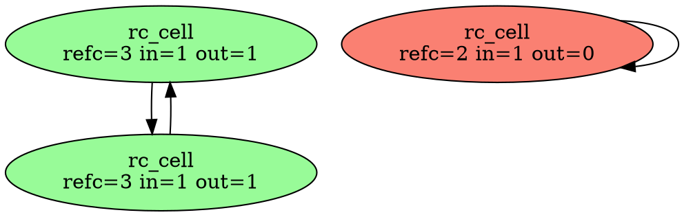

# p1 — trace callbacks: ERTS collects cycles among NIF resources

Point **A1** of [`../README.md`](../README.md). A patch to ERTS (OTP 29.0.1)
that lets a NIF resource type say *which resources it holds*, so ERTS itself
finds and breaks garbage cycles among resources. The design is CPython's
`tp_traverse`/`tp_clear`, with a concurrent validation step because BEAM
schedulers never stop. There are three parts: the collector, the NIF API, and
the tools a developer uses to watch it.

> **This is v2.** v1 (commit `b753189` in the OTP tree) had a global lock, two
> extra words in every resource, O(live) rounds and NIF-only observability.
> v2 removes all four without dropping a guarantee: see
> **[OVERHEAD.md](OVERHEAD.md)** for how, the race it found, and the
> measurements. The beam-lisp namespace is in **[bl/](bl/README.md)**.

- patch: [`../otp/patches/0001-resource-cycles-trace-callbacks.patch`](../otp/patches/0001-resource-cycles-trace-callbacks.patch)
  (`erl_nif_trace.{h,c}` new; ~60 hook lines in `erl_nif.c`, `erl_binary.h`,
  `global.h`, `bif.c`, `erl_bif_info.c`, `erl_bif_unique.{c,h}`,
  `erl_io_queue.c`, `io.c`)
- client + probes: `nif/` · run: `./run.sh` (stock and patched), `./run.sh bl`

## 1. The problem, in ERTS terms

A NIF resource is a *magic binary*: `intern.refc` counts every holder — each
process-heap reference (`ErtsMRefThing` on the process's off-heap list), each
ETS row, each `enif_keep_resource`, and each reference inside **another
resource's** saved terms. The process GC decrements a resource's count when it
finds a dead reference on its own heap (`sweep_off_heap` in `erl_gc.c`); a
resource dies at 0.

A resource that holds terms — beam-lisp's atom, delay, promise and lazy-seq
cells — can hold a reference to itself, directly or through other resources.
That count never reaches 0, and no process GC can ever see it: a garbage
cycle is, by definition, referenced from no process heap. *The BEAM Book*
§12.6.1 notes that Erlang terms cannot form cycles, which is why ERTS has no
cycle collector; §11.12.3 notes that refcounted binaries "never refer to
other objects". Resources that store terms break both assumptions.

Today beam-lisp works around this from outside (`native/lazy_memo/src/collector.rs`):

| needs | outside ERTS (today) | inside ERTS (p1) |
|---|---|---|
| a resource's refcount | private offset, **calibrated** at load | `bin->intern.refc` |
| its identity | private reference-number offset + ETF key | the `ErtsResource*` |
| what a term holds | `term_to_binary` of every saved term, parsed (O(term size)) | the owned env's **off-heap list** (O(#refs)) |
| resource boundaries | per-crate registry | `resource->type` |

## 2. The API (additive; `erl_nif_trace.h`)

```c
typedef struct {
    void (*trace)(ErlNifEnv*, void* obj, ErlNifTraceCtx*);  /* report held refs */
    void (*clear)(ErlNifEnv*, void* obj);                    /* drop them       */
    unsigned long long (*epoch)(void* obj);                  /* lock-free       */
} ErlNifResourceCycleHooks;

int  enif_set_resource_cycle_hooks(ErlNifResourceType*, const ErlNifResourceCycleHooks*);
int  enif_resource_cycles_track(void* obj);        /* object is fully built   */
void enif_trace_env(ErlNifTraceCtx*, ErlNifEnv* owned_env);
void enif_trace_resource(ErlNifTraceCtx*, void* obj);   /* a kept native handle */
void enif_trace_opaque(ErlNifTraceCtx*);            /* "can't say": be a root */
```

Observability and control are **not** NIF calls (v2). They are part of the
emulator, so they work from Erlang, Elixir or beam-lisp without loading
anything (§4):

```erlang
erlang:system_info(resource_cycles)
erlang:system_flag(resource_cycles, {collect, Pid} | {collect, Pid, full}
                                  | {graph, Pid} | {subscribe, Pid}
                                  | {unsubscribe, Pid} | {auto, Bool}
                                  | {threshold, N} | {interval, Ms} | {budget, N})
```

Decisions, and why:

- **`enif_trace_env`, not `enif_trace_term`.** A cell stores its terms in a
  process-independent env. ERTS already links every magic ref and resource
  binary created in that env onto the env's off-heap list (phony process
  `MSO` + heap fragments). That list *is* the exact set of counts the env
  holds: nested in tuples, maps, **fun closures** or resource binaries, and
  including garbage terms still sitting in the env (which really do hold
  counts). A term walk would cost O(size) and could miss such garbage.
- **`track` is explicit** (CPython's `PyObject_GC_Track`). `enif_alloc_resource`
  returns raw memory; registering there would let the collector call `trace`
  on an uninitialised object. Call it **last**, after `enif_make_resource` +
  `enif_release_resource`: the allocation's own release then is not recorded
  as a cycle candidate (OVERHEAD.md §5: 8000M → 7680M instructions per 1M
  cells).
- **`set_resource_cycle_hooks` only during load/upgrade, only for a type with
  a destructor.** The destructor pins the library (`dynlib_refc`) while
  objects exist, so the hook code cannot be unloaded under a round. Only
  objects allocated *after* the call carry the collector's link.
- **Hooks live in a side table**, not in `ErlNifResourceTypeInit`, whose layout
  is frozen NIF ABI. Upstream would add a `members` bump instead (A10).
- **Symbols are resolved with `dlsym`.** The client `.so` links against nothing
  new and loads on stock ERTS, where it simply does not collect.
- **Per-object state lives only in traced objects** (v2): a 56-byte `RcLink`
  after the user data, flagged by `BIN_FLAG_RC_TRACED` on the binary.
  `ErtsResource` is unchanged; `ErlNifResourceType` gains one pointer.

## 3. A round (concurrent trial deletion)

On its own unmanaged thread (`resource_cycles`, started lazily by the first
`set_resource_cycle_hooks` or request), so it never occupies or blocks a
scheduler:

1. **Candidates + pin.** A *partial* round (the normal kind) takes every
   scheduler shard's candidate stack: objects whose count was dropped and
   stayed above zero since the last round (Bacon–Rajan; OVERHEAD.md §2c). A
   *full* round (explicit request, graph view, or amortised after a budget
   overflow) walks every shard's census instead. Each node is pinned with
   `refc++ unless 0`: a resource at 0 is already dying (its destructor is
   queued as aux work) and is skipped, never resurrected. A pin keeps every
   object alive for the whole round, so no hook races a destructor.
2. **Trace + expand.** For each node: read `epoch`, call `trace` (the object
   takes its own lock), `internal[target]++`. In a partial round, a traced
   target not yet in the round is pinned and added (up to `budget` nodes;
   past it, nodes become opaque roots and the round reports `overflow`).
   Edges to untraced resources are dropped: they cannot close a cycle.
3. **Outside count.** `outside = refc − 1 (pin) − internal`. `outside > 0`
   (held by a process, ETS, a non-traced holder, a native handle) → **root**.
   An `opaque` trace → root.
4. **Mark.** BFS from the roots. Reached = live, and each gets a `parent`
   (this is the "why alive" tree). Unreached = candidate set G.
5. **Validate**, in this order:
   - **A.** every g ∈ G re-reads `outside == 0`;
   - **B.** every g ∈ G has an unchanged `epoch`.
6. **Break.** `clear(g)` for each g; then unpin all. Counts fall to 0 in
   ERTS's own order and the ordinary destructors run (as aux work, as always).

**Why A-then-B is sound without stopping mutators.** After the trace, a
process can gain a reference into G only by *reading* a G cell (every holder
of a G member is in G), and that first read needs a reference it held since
before the trace. Pass A proves no such reference exists *now*, so it was
dropped before A inspected that cell, which means the read happened before
pass B inspected it and bumped its epoch. Hence, after both passes, nobody
holds or can obtain a reference into G. This is the same argument as
`collector.rs`; here the refcount and edge counts are exact rather than
calibrated. If validation fails, nothing is cleared: the candidates are
counted in `aborted`, recorded again, and the next round retries.

**Why a partial round is as sound as a full one.** A node outside the round
that holds a count on a node inside it is invisible to the trace, so the
inside node shows `outside > 0` and is a root. Over-approximating roots is
always safe; it only defers collection to a round with the right candidates.
Completeness rests on every count-drop being recorded, which the patch
guarantees by routing every decrement site through `erts_bin_release`
(audit and the one race it found: OVERHEAD.md §2c, §4).

**Residual (unchanged from today).** ETF revival: `binary_to_term` of a binary
taken earlier finds a *live* resource by reference number through the
magic-ref table (`erts_magic_ref_lookup_bin`, which does `refc++ unless 0`).
Against a candidate cycle whose members are still alive, such a revival
bumps the refcount, so pass A fails and the round aborts. After a clear the
object has an empty state, and a client reads it as `reclaimed`, exactly as
with a weak reference.

**Scheduling (v2).** Idle costs nothing: with no candidates the thread sleeps
without a timeout. The first candidate wakes it; it batches for `interval` ms
(default 100) unless a scheduler's shard reaches `threshold` (default 4096)
or a request arrives, then runs one partial round. After a budget overflow, a
full round runs once the candidates that passed since the last full round
reach the live count, i.e. amortised O(1) per candidate.

## 4. Observability: what a developer sees

Everything is surfaced through the emulator (no NIF needed), and twice more
as tools: `nif/rc_ctl.erl` + `nif/rc_observe.erl` for Erlang, and the
beam-lisp namespace **`erts.rc`** ([bl/README.md](bl/README.md)).

**`erlang:system_info(resource_cycles)`** (stock: `badarg`, itself a
capability probe). In beam-lisp: `(rc/info)` / `(rc/stats)`.

```erlang
#{enabled => true, auto => true, rounds => 41, full_rounds => 2,
  collected => 5370, aborted => 0, overflows => 1,
  candidates => 6120, scanned => 9001, live => 1203, pending => 0,
  threshold => 4096, interval_ms => 100, budget => 65536, shards => 43,
  last => #{round => 41, kind => partial, candidates => 3, nodes => 3,
            roots => 1, garbage => 2, collected => 2, aborted => 0,
            opaque => 0, overflow => false, usec => 14},
  types => [#{module => rc_cell, name => rc_cell, live => 1203,
              collected => 5370}]}
```

**`erlang:system_flag(resource_cycles, Op)`** is how to ask for things.
Every request is asynchronous and the answer arrives as a message, so a long
round never blocks a scheduler:

| Op | returns | then |
|---|---|---|
| `{collect, Pid}` / `{collect, Pid, full}` | `Ref` | `Pid ! {resource_cycles, Ref, collected, Round}` |
| `{graph, Pid}` | `Ref` | `Pid ! {resource_cycles, Ref, graph, #{nodes, edges, parent}}` |
| `{subscribe, Pid}` / `{unsubscribe, Pid}` | `ok` | after every round: `Pid ! {resource_cycles, round, Round}` |
| `{auto, Bool}`, `{threshold, N}`, `{interval, Ms}`, `{budget, N}` | old value | policy changes at once |

**The graph** is a *dry full* round: nothing is collected. It gives each
node's `refc`, `internal` and `outside` counts, its `epoch`, whether it was
`traced`, and a `verdict` of `root | live | garbage`. `edges` are held
references, and `parent` is the BFS tree from the roots, i.e. the reason each
live node is alive. The verdicts are exactly the ones the collector would
reach.

**Developer tools** (Erlang `rc_observe`, beam-lisp `erts.rc`):

```
rc_observe:summary()   live=3 rounds=2 collected=0 aborted=0 last: partial nodes=3 garbage=0 14us
rc_observe:why(B)      {alive,[#{verdict=>root, refc=>3, internal=>1, outside=>1,
                                 held_from_outside=>1}]}
rc_observe:garbage()   resources the next round would free, right now
rc_observe:dot(F)      Graphviz: roots green, live grey, garbage red
rc_observe:watch(Ms)   print every round as it happens (subscription)

(rc/why cell)  (rc/garbage)  (rc/dot)  (rc/watch 5000)  (rc/leak-check f)
```

Real `dot` output (a held pair plus a dropped self-cycle):



## 5. Results

### Probe suite (`run.sh`; 23 probes, `nif/rc_test.erl`)

| probe | stock ERTS | patched |
|---|---|---|
| self-cycle ×100 | **leaks 100** | freed |
| pair cycle ×50 | **leaks 100** | freed |
| ring of 1000 | **leaks 1000** | freed |
| cycle through a fun closure ×100 | **leaks 100** | freed |
| cycle through a map + 200-byte binary ×100 | **leaks 100** | freed |
| live cycle (held by the test process) | survives | survives |
| cycle held only by an ETS row | survives | survives |
| cycle held only by another process | survives | survives |
| acyclic garbage | freed (refcount) | freed (refcount) |
| reader walks a live 200-ring 20 000 steps while 40 rounds run | n/a | never sees `reclaimed` |
| writer rewires a live pair 20 000× while 40 rounds run | n/a | intact |
| graph: held pair = root + live, dropped self-cycle = garbage, 3 edges | n/a | ✓ |
| subscription delivers rounds | n/a | ✓ |
| 16 processes × 200 self-cycles at once (all shards) | **leaks 3200** | freed |
| last count dropped by `ets:delete` / holder exit / unread message on a killed process / `persistent_term:erase` | **leaks 50** each | freed |
| 1 garbage pair among 20 000 live cells | n/a | partial round, < 100 nodes, 2 collected |
| 500-ring with budget 64 | n/a | overflow → full round → freed |
| 1000 untraced resources | n/a | not tracked (live += 0) |
| `auto` off: garbage waits 300 ms, then a request frees it | n/a | ✓ |
| no request at all: the automatic trigger frees garbage | n/a | ✓ |

Patched v2: 15/15 consecutive full-suite runs green (after the release/drain
race fix, OVERHEAD.md §4). Stock: every leak probe measures the leak exactly
(`{pass,{leaked_on_stock,N}}`), every liveness probe passes.

**Harness bugs found along the way (v1 and v2), all instructive:**

1. `graph_explains_liveness` first reported *both* cells of a held pair as
   `root`. The collector was right: both were still live on the test
   process's stack. The fix was in the test (build the pair in a callee).
   The graph view made this obvious; the fix took one minute.
2. One run saw `self_cycle` leave 72 of 100 cells alive. Destructors run as
   scheduler **aux work**, and the harness treated "unchanged for 10 ms" as
   "done". The collector had already cleared all 100; they were queued for
   destruction on a machine at load 30+. The harness now waits for the
   target count (with a 3 s cap) and prints the collector's own counters on
   failure. The general rule: reclamation latency is not correctness.
3. The first v2 bench reported a *full* round over 1000 live cells in 4 µs,
   which was implausible. The bench kept its cells "alive" with
   `_ = length(Live)` after the measured call; the compiler drops that as
   dead code, so the GC freed the cells first. Benches now park live data in
   the process dictionary. `rc_bench` also reports `nodes` next to every
   time, so a number without the work it covers is never shown.

### beam-lisp on the patched emulator

Copying the patched `beam.smp` into a copy of the `e5c05630` drop
(`<drop>/erts-17.0.1/bin/beam.smp`):

- `bl test ref_cycles_test.bl`: 228 passed on v2 (it also passes on stock;
  the `lazy_memo` crate does not use p1 yet);
- `bl test bl/rc_test.bl` (the `erts.rc` namespace against rc_cell): 18
  passed on v2; 4 passed on the stock drop, where it answers `:unavailable`.

### Cost

The full measurements and method are in **[OVERHEAD.md](OVERHEAD.md) §5**.
They use instruction counts, because the host was at load 46–58, and are
taken against a pristine emulator rebuilt from the same tree. In summary:

| | v1 | v2 |
|---|---|---|
| untraced resources, plain binaries | +2 words each; ~noise | **nothing** (within ±1% of pristine) |
| traced cell lifetime (100k ×10) | +12.4% instructions | **+6.3%** |
| 8 processes × 50k traced allocs | 3× pristine (global lock) | **≈ pristine** |
| round after 1 pair dropped among 100k live | 97–129 ms (every node) | **20–26 µs, 2 nodes** |
| full round, 100k live | 97–129 ms | 42–51 ms |

### Not verified

- Only OTP 29.0.1 on x86_64 Linux, `opt` build, JIT flavour. The patch has not
  been tried on the `debug` or `emu` flavours.
- Module upgrade/takeover: hooks are replaced in place, but no probe reloads
  the library under live cells.
- `enif_trace_resource` (kept native handles) and `enif_trace_opaque` are not
  exercised by `rc_cell`; the `lazy_memo` `Cursor` (a native handle on its
  source cell) is the natural test.
- Lock-order review (v2): no allocation, release or destruction path takes
  `rc_ctl`; the shard locks guard only list links and are never held while
  calling hooks; hooks take only the object's own lock. `enif_send` from the
  collector thread is used as for any unmanaged thread. This has been
  reviewed, not model-checked, and not run under the lock checker
  (`TYPE=debug` / `ERTS_ENABLE_LOCK_CHECK`).
- The release/drain protocol (OVERHEAD.md §4) was found by a failing probe
  and closed with an argument. It has not been model-checked (a TLA+ or
  loom-style model of stack, flag, refcount and inflight is the right next
  step before upstreaming).
- Distribution: an external ref to a resource is a plain ref (no count), so
  it cannot keep or break a cycle. Unchanged from stock.

## 6. Next steps

1. **Adopt in `lazy_memo`** (behind a load-time capability check):
   - `MemoCell`, `Cursor` and `Seen` register hooks;
   - `track` is called last in each constructor;
   - `trace` = `enif_trace_env` over the state env (and `enif_trace_resource`
     for `Cursor.source`);
   - `clear` = take the state;
   - `epoch` = `version` + `touched` folded into one counter;
   - `collector.rs` stays as the stock fallback (A2–A4 make it sturdier);
   - `ref_cycles_test.bl` gains a `:collector` field (`:erts | :calibrated |
     :off`) and runs on both;
   - `erts.rc` moves from `research/…/bl` to `priv/lib/erts/rc.bl`.
2. **Scoped graph:** `{graph, Pid, Resource}` answers "why is this alive" in
   O(its reach) instead of a full round (OVERHEAD.md §6).
3. **Lock checker + model:** run the probes on a `TYPE=debug` emulator with
   the lock checker on; model the release/drain protocol.
4. **Generational scanning** (index A8's second half) if a real workload
   shows large live structures rewritten near their roots (`rc_churn`).
5. **Drop plumbing (F1):** `bl self-update` builds the patched emulator from
   `otp/patches/` for the pinned OTP tag and records it in `BUILD_INFO`.
6. **Upstream draft (A10):** fold the side table into
   `ErlNifResourceTypeInit` (`members = 5`); document
   `system_info`/`system_flag(resource_cycles)`; write an EEP.
