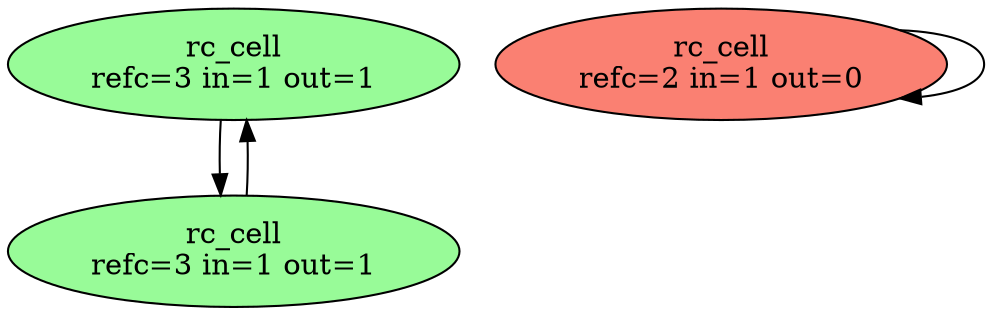

# p1 — trace callbacks: ERTS collects cycles among NIF resources

Point **A1** of [`../README.md`](../README.md). A patch to ERTS (OTP 29.0.1)
that lets a NIF resource type say *which resources it holds*, so ERTS itself
finds and breaks garbage cycles among resources. The design is CPython's
`tp_traverse`/`tp_clear`, with a concurrent validation step because BEAM
schedulers never stop. There are three parts: the collector, the NIF API, and
the tools a developer uses to watch it.

- patch: [`../otp/patches/0001-resource-cycles-trace-callbacks.patch`](../otp/patches/0001-resource-cycles-trace-callbacks.patch)
  (`erl_nif_trace.{h,c}` new; `erl_nif.c` +11, `global.h` +2,
  `erl_bif_info.c` +4)
- client + probes: `nif/` · run: `./run.sh` (stock and patched)

## 1. The problem, in ERTS terms

A NIF resource is a *magic binary*: `intern.refc` counts every holder — each
process-heap reference (`ErtsMRefThing` on the process's off-heap list), each
ETS row, each `enif_keep_resource`, and each reference inside **another
resource's** saved terms. The process GC decrements a resource's count when it
finds a dead reference on its own heap (`sweep_off_heap` in `erl_gc.c`); a
resource dies at 0.

A resource that holds terms — beam-lisp's atom, delay, promise and lazy-seq
cells — can hold a reference to itself, directly or through other resources.
That count never reaches 0, and no process GC can ever see it: a garbage
cycle is, by definition, referenced from no process heap. *The BEAM Book*
§12.6.1 notes that Erlang terms cannot form cycles, which is why ERTS has no
cycle collector; §11.12.3 notes that refcounted binaries "never refer to
other objects". Resources that store terms break both assumptions.

Today beam-lisp works around this from outside (`native/lazy_memo/src/collector.rs`):

| needs | outside ERTS (today) | inside ERTS (p1) |
|---|---|---|
| a resource's refcount | private offset, **calibrated** at load | `bin->intern.refc` |
| its identity | private reference-number offset + ETF key | the `ErtsResource*` |
| what a term holds | `term_to_binary` of every saved term, parsed (O(term size)) | the owned env's **off-heap list** (O(#refs)) |
| resource boundaries | per-crate registry | `resource->type` |

## 2. The API (additive; `erl_nif_trace.h`)

```c
typedef struct {
    void (*trace)(ErlNifEnv*, void* obj, ErlNifTraceCtx*);  /* report held refs */
    void (*clear)(ErlNifEnv*, void* obj);                    /* drop them       */
    unsigned long long (*epoch)(void* obj);                  /* lock-free       */
} ErlNifResourceCycleHooks;

int  enif_set_resource_cycle_hooks(ErlNifResourceType*, const ErlNifResourceCycleHooks*);
int  enif_resource_cycles_track(void* obj);        /* object is fully built   */
void enif_trace_env(ErlNifTraceCtx*, ErlNifEnv* owned_env);
void enif_trace_resource(ErlNifTraceCtx*, void* obj);   /* a kept native handle */
void enif_trace_opaque(ErlNifTraceCtx*);            /* "can't say": be a root */
/* observability */
ERL_NIF_TERM  enif_resource_cycles_info(ErlNifEnv*);
ERL_NIF_TERM  enif_resource_cycles_graph(ErlNifEnv*);
unsigned long enif_resource_cycles_collect(ErlNifEnv*, int wait);
int           enif_resource_cycles_subscribe(ErlNifEnv*, const ErlNifPid*);
```

Decisions, and why:

- **`enif_trace_env`, not `enif_trace_term`.** A cell stores its terms in a
  process-independent env. ERTS already links every magic ref and resource
  binary created in that env onto the env's off-heap list (phony process
  `MSO` + heap fragments). That list *is* the exact set of counts the env
  holds: nested in tuples, maps, **fun closures** or resource binaries, and
  including garbage terms still sitting in the env (which really do hold
  counts). A term walk would cost O(size) and could miss such garbage.
- **`track` is explicit** (CPython's `PyObject_GC_Track`). `enif_alloc_resource`
  returns raw memory; registering there would let the collector call `trace`
  on an uninitialised object.
- **Hooks live in a side table**, not in `ErlNifResourceTypeInit`, whose layout
  is frozen NIF ABI. Upstream would add a `members` bump instead (A10).
- **Symbols are resolved with `dlsym`.** The client `.so` links against nothing
  new and loads on stock ERTS, where it simply does not collect.
- **`ErtsResource` gains two words** (`rc_type`, `rc_tracked`): the type is
  resolved once, at track time, and the destructor leaves the registry in
  O(1).

## 3. A round (concurrent trial deletion)

On its own unmanaged thread (`resource_cycles`, started lazily by the first
`set_resource_cycle_hooks`), so it never occupies or blocks a scheduler:

1. **Snapshot + pin.** Under `rc_lock`, pin every tracked resource with
   `refc++ unless 0`. A resource at 0 is already dying (its destructor is
   queued as aux work) and is skipped; it is never resurrected. A pin keeps
   every object alive for the whole round, so no hook races a destructor.
2. **Trace.** For each node: read `epoch`, call `trace` (the object takes its
   own lock), map edges to snapshot indices, `internal[target]++`. Edges to
   untracked resources are dropped, since they cannot close a cycle through
   the snapshot.
3. **Outside count.** `outside = refc − 1 (pin) − internal`. `outside > 0`
   (held by a process, ETS, a non-traced holder, a native handle) → **root**.
   An `opaque` trace → root.
4. **Mark.** BFS from the roots. Reached = live, and each gets a `parent`
   (this is the "why alive" tree). Unreached = candidate set G.
5. **Validate**, in this order:
   - **A.** every g ∈ G re-reads `outside == 0`;
   - **B.** every g ∈ G has an unchanged `epoch`.
6. **Break.** `clear(g)` for each g; then unpin all. Counts fall to 0 in
   ERTS's own order and the ordinary destructors run (as aux work, as always).

**Why A-then-B is sound without stopping mutators.** After the trace, a
process can gain a reference into G only by *reading* a G cell (every holder
of a G member is in G), and that first read needs a reference it held since
before the trace. Pass A proves no such reference exists *now*, so it was
dropped before A inspected that cell, which means the read happened before
pass B inspected it and bumped its epoch. Hence, after both passes, nobody
holds or can obtain a reference into G. This is the same argument as
`collector.rs`; here the refcount and edge counts are exact rather than
calibrated. If validation fails, nothing is cleared: the candidates are
counted in `aborted` and the next round retries.

**Residual (unchanged from today).** ETF revival: `binary_to_term` of a binary
taken earlier finds a *live* resource by reference number through the
magic-ref table (`erts_magic_ref_lookup_bin`, which does `refc++ unless 0`).
Against a candidate cycle whose members are still alive, such a revival
bumps the refcount, so pass A fails and the round aborts. After a clear the
object has an empty state, and a client reads it as `reclaimed`, exactly as
with a weak reference.

**Scheduling.** A round runs when `since ≥ threshold` (tracked allocations
since the last round) or on request. After a round,
`threshold = max(1024, survivors)`: a round costs O(live), so it runs again
only after as many new objects as survived. That is amortised O(1) per
allocation, the classic generational-trigger argument.

## 4. Observability: what a developer sees

Everything is surfaced three ways: from Erlang or beam-lisp *without any
NIF*, from the NIF API, and as developer tools (`nif/rc_observe.erl`).

**`erlang:system_info(resource_cycles)`** (a new `system_info` item; stock
answers `badarg`, which is itself a capability probe). In beam-lisp:
`(erlang/system_info :resource_cycles)`.

```erlang
#{enabled => true, rounds => 2, collected => 0, aborted => 0,
  threshold => 1024, since => 0, live => 3,
  last => #{round => 2, nodes => 3, roots => 2, garbage => 0,
            opaque => 0, usec => 2},
  types => [#{module => rc_cell, name => rc_cell, live => 3, collected => 0}]}
```

**The graph** (`enif_resource_cycles_graph`): a *dry* round, where nothing is
collected, returned as data. Each node has its `refc`, `internal` and
`outside` counts, its `epoch`, and a `verdict` of `root | live | garbage`.
Edges are held references. `parent` is the BFS tree from the roots, i.e. the
reason each live node is alive. The verdicts are exactly the ones the
collector itself would reach.

**Developer tools** (`rc_observe`):

```
rc_observe:summary()   live=3 rounds=2 collected=0 aborted=0 last: nodes=3 garbage=0 2us
rc_observe:why(B)      {alive,[#{verdict=>root, refc=>3, internal=>1, outside=>1,
                                 held_from_outside=>1}]}
rc_observe:garbage()   resources the next round would free, right now
rc_observe:dot(F)      Graphviz: roots green, live grey, garbage red
rc_observe:watch(Ms)   print every round as it happens (subscription)
```

Real `dot/1` output (a held pair plus a dropped self-cycle):



**Subscription** (`enif_resource_cycles_subscribe`): after every round, the
subscriber receives `{resource_cycles, #{round, nodes, roots, garbage, opaque,
usec}}`. That is enough for a live dashboard or a datom sink (D1).

## 5. Results

### Probe suite (`run.sh`; 13 probes, `nif/rc_test.erl`)

| probe | stock ERTS | patched |
|---|---|---|
| self-cycle ×100 | **leaks 100** | freed |
| pair cycle ×50 | **leaks 100** | freed |
| ring of 1000 | **leaks 1000** | freed |
| cycle through a fun closure ×100 | **leaks 100** | freed |
| cycle through a map + 200-byte binary ×100 | **leaks 100** | freed |
| live cycle (held by the test process) | survives | survives |
| cycle held only by an ETS row | survives | survives |
| cycle held only by another process | survives | survives |
| acyclic garbage | freed (refcount) | freed (refcount) |
| reader walks a live 200-ring 20 000 steps while 40 rounds run | n/a | never sees `reclaimed` |
| writer rewires a live pair 20 000× while 40 rounds run | n/a | intact |
| graph: held pair = root + live, dropped self-cycle = garbage, 3 edges | n/a | ✓ |
| subscription delivers rounds | n/a | ✓ |

Patched: 25/25 consecutive full-suite runs green after the harness fix below
(10 + 5 + 10 across three rebuilds of the final patch).
Stock: the five leak probes measure the leak exactly (`{pass,{leaked_on_stock,N}}`).

**Two harness bugs this found, both instructive:**

1. `graph_explains_liveness` first reported *both* cells of a held pair as
   `root`. The collector was right: both were still live on the test
   process's stack. The fix was in the test (build the pair in a callee).
   The graph view made this obvious; the fix took one minute.
2. One run saw `self_cycle` leave 72 of 100 cells alive. Destructors run as
   scheduler **aux work**, and the harness treated "unchanged for 10 ms" as
   "done". The collector had already cleared all 100; they were queued for
   destruction on a machine at load 30+. The harness now waits for the
   target count (with a 3 s cap) and prints the collector's own counters on
   failure. The general rule: reclamation latency is not correctness.

### beam-lisp on the patched emulator

Copying the patched `beam.smp` into a copy of the `e5c05630` drop
(`<drop>/erts-17.0.1/bin/beam.smp`):

- `bl test test/bl/ref_cycles_test.bl`: green (it also passes on stock; the
  `lazy_memo` crate does not use p1 yet);
- `(erlang/system_info :resource_cycles)` answers the map; stock raises
  `badarg`.

### Cost (`nif/rc_bench.erl`, best of 5, host load 30–40, so treat as upper bounds)

| cells | alloc µs/op stock | alloc µs/op patched | one round over N **live** cells | reclaim all N cyclic garbage (end-to-end) |
|---|---|---|---|---|
| 1 000 | 1.8 | 5.2 | 0.9 ms | 5.3 ms |
| 10 000 | 2.0 | 2.7 | 5.5 ms | 7.3 ms |
| 100 000 | 2.8 | 3.6 | 50 ms | 8.4 ms |

What the numbers say:

- **Allocation overhead** is one mutex plus a hash insert. It sits within the
  noise at 10k and is ~+0.8 µs/op at 100k. It is a single global lock: under
  heavy parallel allocation it is the first thing to shard (per-scheduler
  registries).
- **A round is O(live)**, ~0.5 µs per live object, and runs off-scheduler. The
  adaptive threshold keeps the *amortised* cost O(1) per allocation, but a
  large live heap still pays the full scan each time. That makes A8
  (incremental candidate roots) the next real improvement.
- **Reclaiming 100 000 cyclic objects takes ~8 ms** end to end, much less
  than one 100k live scan, because auto rounds already ran during
  construction.

### Not verified

- Only OTP 29.0.1 on x86_64 Linux, `opt` build, JIT flavour. The patch has not
  been tried on the `debug` or `emu` flavours.
- Module upgrade/takeover: hooks are replaced in place, but no probe reloads
  the library under live cells.
- `enif_trace_resource` (kept native handles) and `enif_trace_opaque` are not
  exercised by `rc_cell`; the `lazy_memo` `Cursor` (a native handle on its
  source cell) is the natural test.
- Lock-order review: `rc_lock` is never held while calling hooks, and hooks
  take only the object's lock. `enif_send` from the collector thread is used
  as for any unmanaged thread. This has been reviewed, not model-checked.
- Distribution: an external ref to a resource is a plain ref (no count), so
  it cannot keep or break a cycle. Unchanged from stock.

## 6. Next steps

1. **Adopt in `lazy_memo`** (behind a load-time capability check):
   - `MemoCell`, `Cursor` and `Seen` register hooks;
   - `trace` = `enif_trace_env` over the state env (and `enif_trace_resource`
     for `Cursor.source`);
   - `clear` = take the state;
   - `epoch` = `version` + `touched` folded into one counter;
   - `collector.rs` stays as the stock fallback (A2–A4 make it sturdier);
   - `ref_cycles_test.bl` gains a `:collector` field (`:erts | :calibrated |
     :off`) and runs on both.
2. **`bl` surface:** a `bl.rc` namespace over `system_info`, graph,
   `why`/`dot` and watch, so `bl doc` cells and the live view can show the
   collector (D1).
3. **Sharded registry** plus **A8 incremental rounds** once `lazy_memo` load
   is measured.
4. **Drop plumbing (F1):** `bl self-update` builds the patched emulator from
   `otp/patches/` for the pinned OTP tag and records it in `BUILD_INFO`.
5. **Upstream draft (A10):** fold the side table into
   `ErlNifResourceTypeInit` (`members = 5`); `system_info(resource_cycles)`
   → `erlang:memory`-style docs; an EEP.
