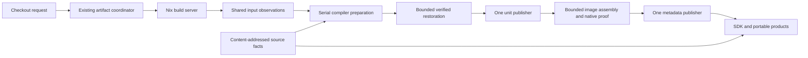

# Incremental build pipeline prototype

This branch routes SDK restoration, application preparation, source priming and
SDK image assembly through one bounded task executor. Nix and the existing
artifact coordinator retain placement, durable job ownership and product custody.

The build tier discovers namespaces from flat file basenames, so these drivers
are named `build-inputs`, `build-execution` and `build-image`. No runtime host,
bootstrap floor or external package was added.



## Ownership and reuse

- `build-inputs/capture` resolves each input namespace once and hashes each
  resolved source path once per observation pass. Unit reuse compares exact
  constructor inputs, compiler/runtime identities and source resolution. A
  separate final observation validates the complete produced input set.
- `build-execution/reduce!` uses the existing native Task entry underlying
  `proc.task`, which is available before the SDK libraries have been compiled.
  Tasks retain Env and executable lifetime. Every completion opens another
  slot; the caller consumes results with bounded outstanding preparation.
  Failure stops and awaits owned tasks and drains their private result messages.
- SDK compiler workspaces stay on one owner. Workers verify and copy immutable
  retained units into private unit directories. The owner writes flat outputs
  and rejects conflicting module ownership. Application dependency waves and
  the toolchain barrier remain ordered; initializer publication retains
  source-plan order through a bounded ready window.
- `build-image/assemble!` gives each worker a small batch of at most sixteen
  complete units with disjoint image files. Task captures contain only that
  batch, avoiding repeated transfer of the whole SDK manifest. It calls the
  existing assembler, source relocator and native SDK
  inventory writer. Each native proof validates actual source and emitted bytes,
  including complete companion membership. The caller merges disjoint ownership
  and writes deterministic SDK and precompiled metadata after preparation succeeds.
- Source parts are primed before the compiler child. The same content-addressed
  frames feed its freshness checks, final image priming and the next unit-store
  archive. Both exact content and the existing build generation select reuse;
  missing or corrupt frames parse normally. Volatile timing stays in logs.
- The closed Nix worker renames retained units within its guest filesystem,
  then explicitly copies to the separate Nix output store without preserving
  guest ownership. SDK image copying requests filesystem reflinks
  with an ordinary-copy fallback. Portable ELF mutations retain separate bytes.

## Validation

Run the complete managed qualification under a process-tree cap:

```sh
scripts/bl-mem
systemd-run --user --collect --wait --pipe --working-directory="$PWD" \
  --property=MemoryMax=4G --property=MemorySwapMax=0 \
  --property=RuntimeMaxSec=10800 \
  python3 test/scripts/build_pipeline_vertical.py \
    --sdk /nix/store/RETAINED-SDK \
    --out .local/build-pipeline/vertical
```

The output directory must not exist. The harness makes a private engine copy;
it never edits the checkout or an immutable product. A configured remote Nix
builder and the normal `max-jobs = 0` policy are mandatory. It records actual
remote dispatch from the durable job stdout events, complete worker phase logs,
input-read counts and immutable product identities.

The run installs the changed producer through ordinary checkout preparation,
then edits existing SDK library Source and builds again. Unchanged unit archives
must remain byte-identical. Independent consumers remove SDK Source, load the
sealed units and expand a packaged macro with zero SDK compilation. An ordinary
application then builds against the exact changed SDK. Finally, fresh-VM and
warm unchanged self-builds must produce identical bytes without new SDK jobs;
the harness stops its private warm realm.

Focused controls additionally compare the new image and both metadata files
byte-for-byte against the existing serial assembler. They exercise bounded
refill while an earlier task is blocked, task cleanup on failure, preserved Env,
changed/deleted/re-resolved inputs, corrupt artifact refusal, parsed-frame reuse
and invalidation, and serial application initializers with unchanged build reuse.

## Remaining boundaries

This is a vertical prototype, not a claim that all builds or all CI lanes have
been qualified. SDK restoration and image stages cap concurrency at four;
application preparation respects its configured jobs, capped at 128, with at
most twice that many active-or-ready items awaiting ordered publication. There is no
new persistent scheduler or per-file cold VM.

Nix evaluation and durable coordination still run on the work server. Realization
runs on the configured build server. Compiler P/B/C qualification and actual
runtime-target compatibility checks remain required; this prototype does not
weaken them. SDK and portable images still require distinct sealing because their
native ELF bytes differ. Worker phase time, end-to-end request time and unchanged
warm linking must be reported separately.

## What the measured prototype establishes

The full SDK/application qualification passed at production-source revision
`dbdb1d6db`, before the separate cross-filesystem copy correction. The matched
library edit rebuilds nine actual constructor units and restores 504 unchanged
units, whose complete archives remain byte-identical.

| Instrumented worker measurement | First prototype | Batched, ordered prototype |
| --- | ---: | ---: |
| Unit production, nine compiled / 504 reused | 65.32 s | 67.93 s |
| Image assembly and native ownership proof | 77.03 s | 58.74 s |
| Freshness priming in the final image | 7.69 s | 7.19 s |
| SDK worker steps, excluding setup | 399.57 s | 400.35 s |

This pair demonstrates no total changed-build latency win. The image stage
improves, while other phases offset that saving. It does not compare against
main with the identical workload: the earlier main measurement rebuilt three
units and took about 445 seconds. Do not present that as an apples-to-apples
speedup. The first prototype already contained shared inputs and source parts.

Both versions reuse 546 of 547 parsed contents after the library edit and parse
only the changed content; final-image priming reuses all 547. Each receipt
validation pass hashes 526 unique source files for 3,068 constructor input
references. These counters describe receipt validation, not every source read
performed anywhere in the compiler.

The ordered prototype's complete changed-SDK request took 624.60 seconds on this
run, including about 224 seconds outside the instrumented worker steps. Its
unchanged link took 11.78 seconds with a fresh VM and 1.27 seconds warm, with
zero SDK jobs and identical candidate bytes. Those warm figures are unchanged
requests, not changed-code compilation.

The next structural work should target these measured remaining costs:

1. About 86 seconds inside the producer are outside its named phases, including
   startup and unseparated gaps. Profile boot/driver loading before designing a
   retained producer package. Any reuse must preserve exact constructor receipts;
   closure-key-only cache adoption is insufficient.
2. Nix evaluation remains on Work and used roughly 2.3 GB in the observed client.
   Capture/evaluation, queuing, transfer and guest setup add minutes outside the
   worker. Work was also under severe I/O pressure with nearly full swap.
3. Image ownership proof still costs about 59 seconds here. Batching improves
   this prototype's per-unit proof approach, but this is not evidence that it
   beats the earlier serial assembler's roughly 35-second, different-build
   measurement. Native proof framing and shared validation deserve profiling.
4. Compiler P/B/C qualification remains expensive after producer-source changes,
   even when compiler units reuse bytes. Separate actual compiler inputs from
   producer implementation only with explicit negative and reproduction controls.
5. Packing both native and portable products, and copying across the guest/output
   filesystem boundary, remain substantial. Cross-filesystem `mv` was rejected
   after it fell back to copying and logged ownership warnings; the explicit
   non-ownership-preserving copy is restored and qualified separately.

The prototype validates the responsibility boundaries and their correctness. It
is not sufficient evidence to merge this branch as a finished latency solution.
Full repository CI and broader target qualification remain outside this run.
