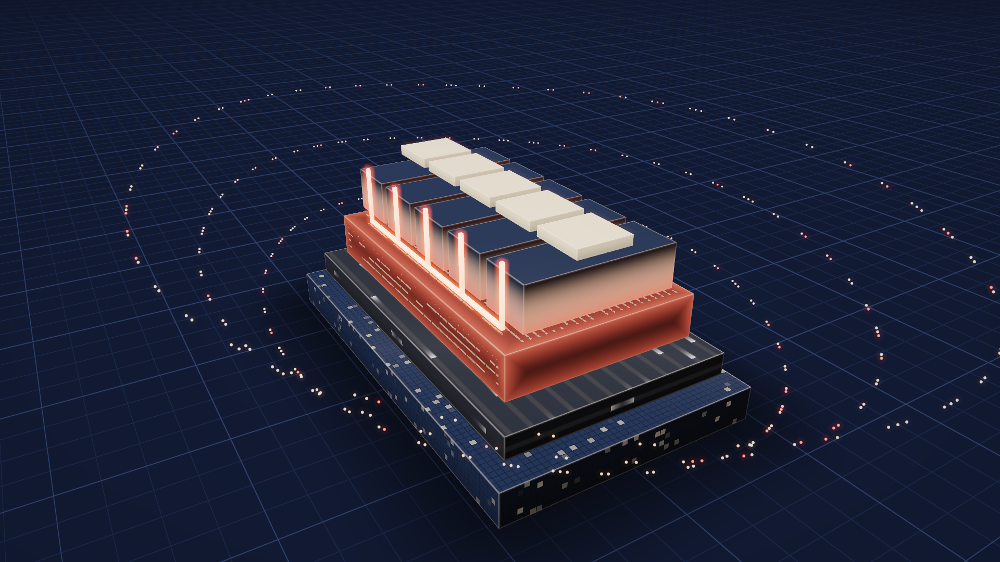

# Proof — shot 03 "The difference is in the foundations"

[`evidence/layers.mp4`](evidence/layers.mp4) shows the five ORA layers landing on the
beat. The coral common block slams in, the scattered motes fall into one rhythm,
and coral lines run to every team. It is 15 s, 1920×1080, 60 fps, with original
AAC stereo.

It also serves as the website's "Layers assembling" animation slot as-is: about
15 s, bottom-up landings, then coral lines from the playbooks layer to each team.



## How it is made

| Part | Owner | File |
|---|---|---|
| Score, camera, landings, glow, shockwave, motes, sound events | BL, pure function of time | `ora_film/layers.bl` |
| Source capture, all-frame plan, seek-history check | BL | `build.bl` |
| Admission checks, drawing, encoding, ffprobe verification | Python + EGL/GLES | `worker.py` (reuses the captured MAKE WORLDS GPU context) |
| Floor grid, engraved materials, motes, bloom/tone | GLSL | `shaders/` |

**Materials** are procedural. None uses a texture.
- **Data foundation:** navy stone with glimmering record cells.
- **Connectors:** graphite with pulses that travel toward the centre.
- **Common block:** brushed coral metal engraved with playbook "text" lines, glowing on the beat.
- **Assistants:** smoked glass lit from below once connected.
- **Teams:** cream ceramic.

The floor is the site's grid laid flat. It has a contact shadow that grows *before*
each landing and a coral shock ring that lights the grid lines it crosses.

## Reproduce

```sh
source research/ora-intro-film/proof/env.sh          # host toolchain + EGL paths
research/ora-intro-film/proof/render.sh /tmp/ora-layers review   # 15 selected PNGs
research/ora-intro-film/proof/render.sh /tmp/ora-layers film     # full MP4
```

The wrapper runs `scripts/bl-mem`, then captures in one cold VM capped at
3 GiB / 256 MiB swap, then draws and encodes in a GPU worker capped at
2 GiB / 256 MiB swap / 15 min. Nothing is left running afterwards.

## Results (2026-10-25, this host)

| Check | Result |
|---|---|
| Capture | 900 frames; seek-history assertion passed; 7.0 s, 248 MiB peak |
| GPU | Mesa Intel UHD Graphics 630 (CML GT2), OpenGL ES 3.2 Mesa 26.1.1 |
| Render + encode + probe | 46.0 s worker time, 879 MiB peak, 0 swap |
| Media (ffprobe) | 900 video frames, 60/1, 1920×1080, 15.000 s; AAC 48 kHz stereo 15.000 s |
| Audio | 66 BL score events; mean −19.2 dBFS, peak −1.3 dBFS |
| Chromium 155 playback | duration 15 s, 1920×1080, plays |
| Chromium seek (blob-loaded) | 12 → 3 → 7.3 → 14.9 s landed exactly; resumes playing |
| Visual review | two review passes of 15 full-size selected frames, then a decoded contact sheet of the encoded film (`evidence/decoded-contact.png`) |

- Revision: `18545260b91e2c7db934b140382e37691e20a8f42d51300e067b2073afc92ae7`
- Film sha256: `722850fd649d6a851bc69430cfc086769917cec5454958c938f40b25a9318d8d`
- Plan sha256: `c20e45d1562abfb190ec4e0a37b111cd9c5ac3f5b51303ff4bda1294a1739b6b`

The full evaluated plan (2.4 MB JSON) is retained as `evidence/plan.json.gz`; its decompressed sha256 matches the value above.

**Review fixes applied between passes:**
- The first 1.5 s were empty. The camera now starts higher, and the shadow grows before the first landing.
- The stone cells were too coarse.
- The connector streaks were too hot.
- The coral block read as flat plastic. It is now darker, more metallic, with less emission.
- The edges looked like wireframe.
- The hero was cropped at the bottom.

## Limits

- **Python's `http.server` cannot serve byte ranges.** Seeking through it returns 0. Serve with a range-capable server when publishing.
- **Not a human audiovisual review.** Automated playback and selected frames don't replace one. The sound is a functional score, not a mixed soundtrack.
- **Lighting is approximate.** There are no real shadows between boxes, and no rounded geometry: bevels are shaded, not modelled.
- **The worker is private to this film.** It is not a general studio feature.
