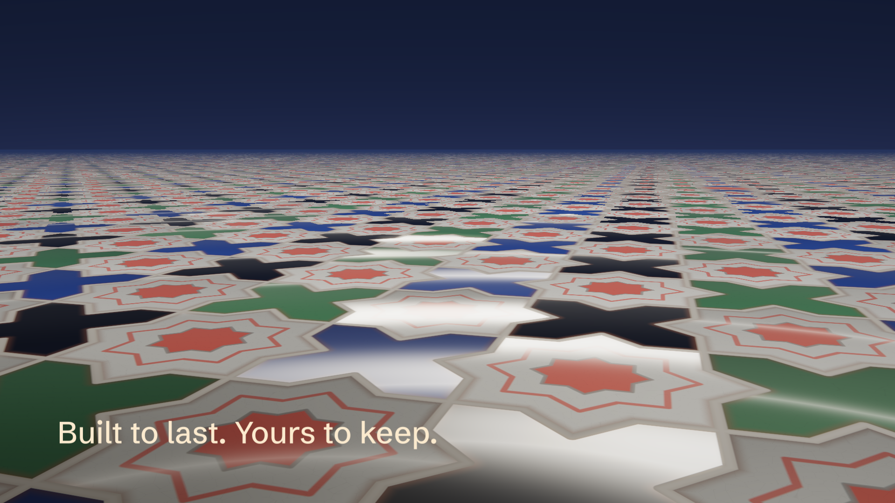

# Zellige — the full film

[`evidence/zellige.mp4`](evidence/zellige.mp4) is the complete 45 s ORA Ventures film:
1920×1080, 60 fps, original stereo sound. The story and why it is told this way
are in [../BRIEF.md](../BRIEF.md); the references are on the [mood board](../moodboard/index.html).



## How it is made

| Part | Owner | File |
|---|---|---|
| Story clock: camera, construction, fit wave, refinement, finale, words, Gnawa score events | BL, pure function of time | `ora_zellige/film.bl` |
| Source and font capture, word shaping, all-frame plan, seek-history check | BL | `build.bl` |
| Admission checks, drawing, word compositing, encoding, ffprobe check | Python + EGL/GLES | `worker.py` |
| Per-pixel tile geometry, glaze and light | GLSL | `shaders/zellige.frag` |
| Guembri, qraqeb, claps, tbel, ceramic taps | Python synthesis of the BL events | `worker.py` |

**The floor:**
- Every pixel casts one ray onto the floor plane.
- The pattern is star-and-cross zellige on a unit lattice: 8-point stars at integer points, crosses between them.
- Each pixel tests the 18 nearby tiles in their *current* positions, so scattered tiles can overlap and drift.
- Each tile's scatter, glaze, tilt and shimmer clock come from a hash of its home position. The fit wave from BL moves it home with a small overshoot.

**The construction lines** are the true generators of this pattern: lines at
x, z = k ± 0.354 and diagonals at x ± z = k + ½.

**The words** use Schibsted Grotesk, the ORA site's display face, now packaged
in `examples/scene-renderer/assets/fonts` with its OFL licence and source hashes.
They are shaped once, rasterised from outlines, and composited after grading, so
bloom never softens them.

## Reproduce

```sh
source research/ora-intro-film/proof/env.sh
research/ora-intro-film/zellige/film/render.sh /tmp/ora-zellige review   # 23 selected PNGs
research/ora-intro-film/zellige/film/render.sh /tmp/ora-zellige film     # the full film
```

## Results (2026-10-25, this host)

| Check | Result |
|---|---|
| Capture | 2,700 frames, seek-history assertion passed, 9.1 s, 325 MiB peak |
| GPU | Mesa Intel UHD Graphics 630, OpenGL ES 3.2 Mesa 26.1.1 |
| Render + encode | 198 s; median 53.9 ms / max 66 ms per frame; 976 MiB peak |
| Canonical media (ffprobe) | 2,700 frames, 60/1, 1920×1080, 45.000 s; AAC 48 kHz stereo 45.000 s |
| Sound | 342 BL score events (guembri, qraqeb, claps, tbel, taps); mean −21.8 dBFS, peak −2.1 dBFS; [spectrogram](evidence/soundtrack-spectrogram.png) |
| Lockup | identical frames at 41.6 s and 44.9 s (`evidence/lockup-landing.png`) |
| Chromium 155 via the tailnet review page | duration 45 s, plays; seeks to 40 → 6 → 19.6 s exactly |

**Second version (audience, values, Gnawa score):**
- The script now speaks to the founder who already uses agents.
- The palette comes from the mood board: white stars with honey, green or cobalt hearts; cobalt, green and black crosses; light cement joints.
- The refinement turns every heart coral.
- Wide glare on light glazes was reduced.
- In the score, a never-decaying string buzz and long tails filled 50 Hz–2 kHz with noise. Both now decay, and the guembri excitation is darker.

**First version, review passes before the final render:**
- Navy, cream and coral in equal parts read as a red-white-blue flag. Coral is now kept for the centre star, the joint light, the refinement and the ring.
- The fragmented glazes looked like felt. They gained a camera-facing softbox, then a narrower band once tiles looked like chrome.
- The craquelure was too coarse at macro scale.
- Glints blew out.
- The field didn't fade under the lockup.
- The camera spline overshot past the lockup and drifted back. It now lands on an eased path and stops exactly.

**Files and hashes.** The canonical encode (CRF 16, 90.0 MB, sha256 `76cc5ebd…1654df`)
is regenerated by `render.sh film`. The committed `evidence/zellige.mp4` is a
CRF 20 re-encode of it (sha256 `2e954251cb172c22…`) with the same frame count
and the original audio stream. The plan, report and provenance are retained.

## Limits

- **No human review yet.** Nobody has watched it through with sound. The sound was checked by measurement only: loudness, a spectrogram, and per-voice band energy.
- **The score is inspired synthesis.** It is not a recording of Gnawa musicians; a release version should commission real players.
- **Lighting is a stylisation.** The glaze model is not physically based.
- **Far tiles are averaged.** Distant tiles blend to an average colour instead of being supersampled.
- **The words are English only.** The site works in French and English.
