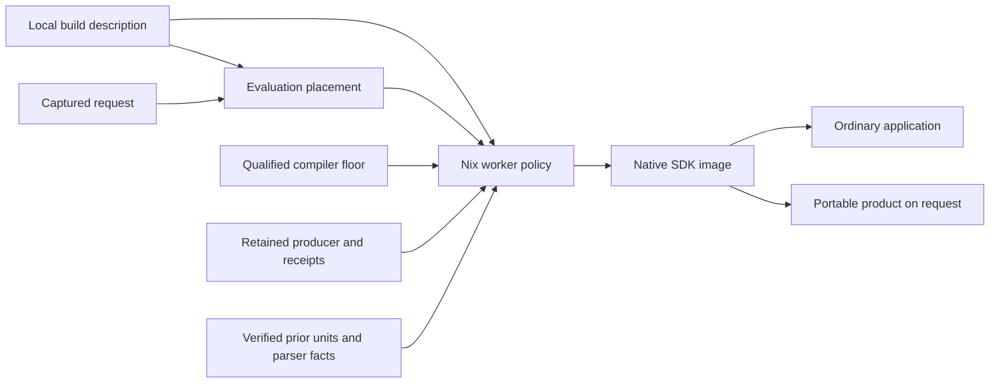

# Retained producer and locally described build placement

This vertical prototype extends `prototype/build-pipeline` and integrates main
through `1a89c9a7f`. It lives on `prototype/retained-producer`; it is not a main
release. Its qualification runs the normal checkout preparation, SDK receiver,
application and public self-build commands against immutable Nix products.



## Changes

- The workstation repository owns station addresses, credentials, host keys and
  capacity. Beam Lisp supplies the generic module/interface. The previous
  concrete station key and address are removed from active configuration.
- `scripts/retain-producer.bl` captures the producer's loaded units plus their
  runtime-require and actual constructor-input closure. `producer-product.nix`
  retains that capsule by content, independently of its containing SDK.
- `scripts/restore-producer.exs` verifies the exact runtime, current tier keys,
  canonical Source contents and native-verified constructor receipts. It seeds
  the existing writable cache through `AOTCache.store`/`prepare_fetch`. Cache
  bytes stay off the executable path; the normal loader owns admission,
  initialization and effects. There is no second activation mechanism.
- Producer publication tooling lives outside the SDK's build tier. Editing it
  does not itself add a compiler-floor Source input or an exported SDK namespace.
- Content/generation checked parser frames prime parent startup as well as the
  library child. Receipts share observations; final freshness checks remain
  independent. Existing bounded task execution and one publisher are preserved.
- Native SDK image production and portable ELF retargeting/packing are separate
  products. The SDK retains the full native payload. Public `self-build` requests
  the portable product on demand through the existing durable coordinator.
  Portable identity binds the exact native image and survives selection-wrapper
  changes. Existing SDKs with a retained `release` field remain consumable.
- CI explicitly consumes the portable product when it needs one. Native-only
  cache hints remain useful after partial failures; successful portable outputs
  receive a separate GC root. Lookup verifies the SDK/image, compiler and actual
  bytes without starting production. Known predecessor capture policies retain
  their original fingerprints.
- Optional station evaluation uses `/etc/beam-lisp/build-station.json`, emitted
  from the local NixOS description. One finite adapter handles SDK, native,
  application and portable operations. It copies captured inputs, executes the
  pinned endpoint, copies and retains the result, then acknowledges remote root
  cleanup. Each request owns a separate root. Configured transport failures do
  not fall back to Work. Bounded build logs return without importing derivation
  and toolchain closures merely to inspect logs.

See [station configuration](../../docs/build/build-station.org) for the local
schema. The existing workstation inventory already describes daemon routing.
Its current key grants the Nix store/build protocol; it does not grant command
execution for the evaluation endpoint. Operator SSH was denied. Realization on
Build is exercised; evaluation on Build is implemented and fixture tested but
has not been activated or qualified on that machine. Source capture and
bootstrap coordinator selection remain local.

## Measured decisions

A single whole-image proof passed byte equivalence and corruption controls, but
its changed-build image stage took 77.4 seconds. Later bounded batch runs took
58.4s and 78.2s under different load. This did not establish a speedup for the
single proof. The prototype keeps bounded complete-unit proofs and one metadata
publisher; the serial experiment was reverted.

The earlier matched prototype compiled nine SDK units and restored 504:
400.35 seconds in worker steps and 624.60 seconds end to end. The final
canonical-cache slice compiled nine and restored 504 byte-identical units in
335.11 seconds of worker steps and 482.61 seconds end to end. Portable
packaging was not requested during that SDK-only interval. These observed runs
show about 16% lower worker time and 23% lower SDK-request time; they do not
establish a twofold improvement. Backend load varied between runs.

| Final integration check | Observed wall time |
| --- | ---: |
| Changed SDK request | 482.61s |
| First explicit portable request, after SDK preparation | 92.62s |
| Unchanged fresh-VM publication | 13.19s |
| Unchanged warm publication | 3.12s |
| Ordinary application against the changed SDK | 82.20s |

The first complete release therefore takes roughly 575s across SDK preparation
and the separate portable request. SDK-only callers avoid that packaging work.
Both unchanged publications return identical bytes, with zero new SDK jobs and
zero additional portable jobs. The warm result is slower than the earlier
1.27s retained-release baseline: canonical Nix selection adds lookup work. This
tradeoff is explicit; the prototype is not presented as fully optimized.

The active Work host exhausted its 16 GB of swap during qualification. An
identical restoration check varied from 1.7 to 78 seconds; full I/O pressure
exceeded 60% over a minute. Local BEAM checks were stopped and the remaining
restoration controls moved into a bounded Nix job on Build. Do not attribute
that variation to compiler changes.

## Qualification

The [machine-readable report](checks.json) records final product identities and measured
scope. Detailed logs and failed intermediate runs remain under
`.local/retained-producer/`; failures are preserved rather than relabeled.

The receiver controls exercise the real normal launcher, actual constructor
and emitter calls, changed inputs, forged input subsets, corrupted unit bytes,
runtime mismatch, unchanged floor bytes and absence of cache files on the
executable path. They use two serial disposable VMs on Build.

```sh
nix-build nix/producer-check.nix --argstr sdk /nix/store/RETAINED-SDK \
  --out-link .local/producer-check
nix-instantiate --eval --strict --json --read-write-mode \
  test/nix/portable-selection.nix --argstr sdk /nix/store/RETAINED-SDK \
  --extra-experimental-features 'nix-command flakes'
```

The Python suite passes 163 tests with three skips. The current producer batch
passes 372 assertions across 11 Source files. A separate real CI smoke job on
Build passes 19 assertions with the native-only SDK and its portable product as
an explicit dependency. The complete integration witness
includes source-free SDK macro/function use,
byte-identical unaffected units, ordinary applications against the selected
SDK, lazy portable production, unchanged fresh/warm publication, an FHS receiver
without `/nix/store`, and the selected SDK's portable runtime/glibc gates. Test
realms use private runtime directories and are stopped in cleanup.

## Remaining costs and main readiness

The retained floor still conservatively includes all build-tier Source in its
qualification identity. Changing those inputs can rerun P/B/C even when all
91 units restore unchanged. No key was narrowed and no old proof was relabeled.
A separate native floor/producer identity contract is still needed to remove
that qualification cost safely.

Native image construction still assembles runtime/dependency files, validates
complete SDK ownership, copies the native payload and packs the native capsule
used by pinning. In the final nine-unit case, unit production was 70.5s,
image validation/assembly 78.2s, native packing 22.5s and image copying 22.9s.
Parent startup/unseparated work was another roughly 47s. Another roughly 147s
sits outside the worker steps: capture, coordinator startup, evaluation,
transfer and queue time. Existing instrumentation does not separate all of
those components. These are the next
structural targets: retained runtime/dependency images, native capsules only
when requested, and reusable native verification evidence with the same
admission guarantees. Warm publication also needs a cheaper canonical-product lookup that preserves
its identity checks. Moving the evaluator requires the locally configured
operator endpoint; an ssh-ng store alone cannot provide it.

This slice does not qualify the whole repository inventory, model-backed lanes,
Android/JS/cross-platform releases or activation of the workstation deployment.
Main can be called fully green only after its complete required CI lanes pass
on the integrated commit. Station evaluation additionally requires deploying
and exercising the local endpoint description. No tag is launched from this
prototype branch.
